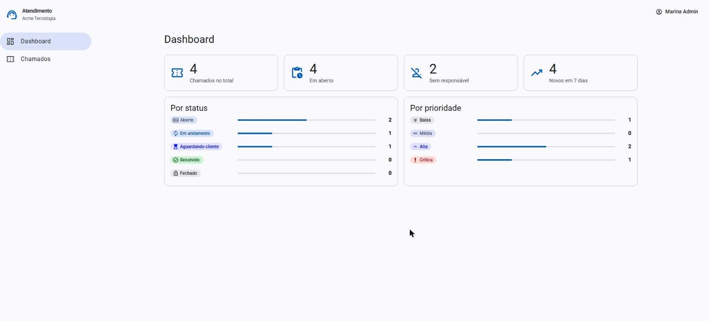
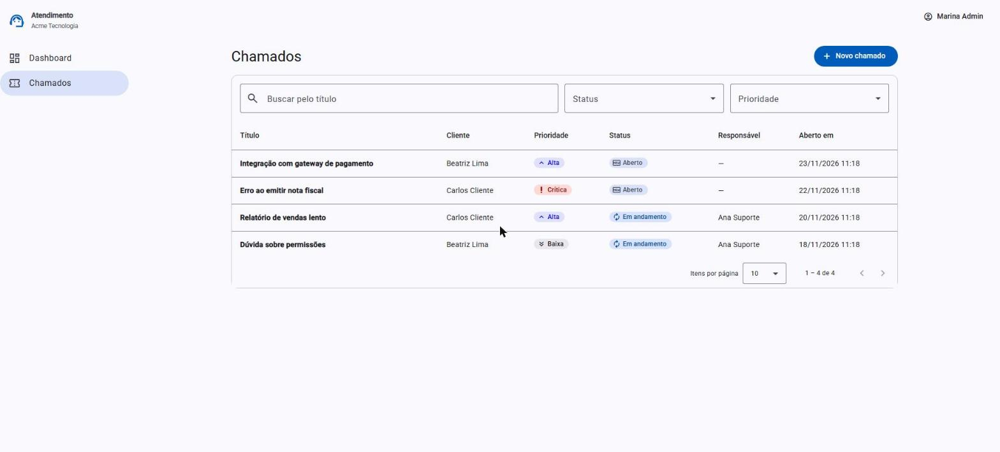
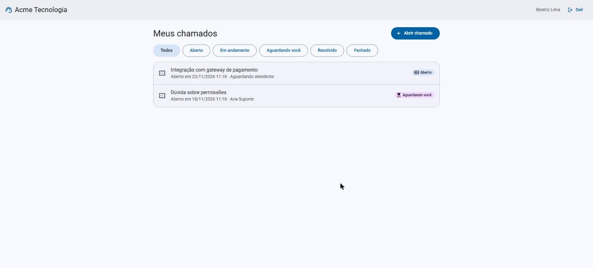
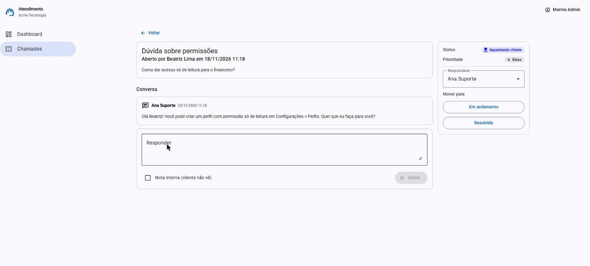
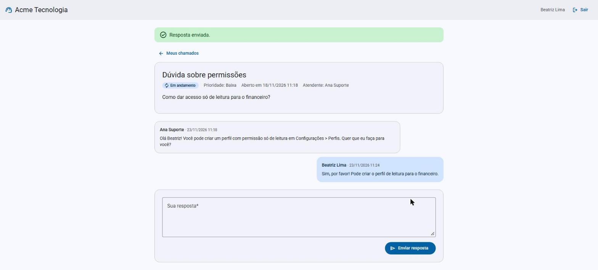

# SaaS Multiempresa · Central de Atendimento

> Projeto de portfólio. Mostra três sistemas em stacks diferentes conversando pela mesma API.

Plataforma de suporte multiempresa (multi-tenant): cada empresa cliente tem seus usuários, chamados e equipe isolados das demais.

| Peça | Stack | Para quem |
|---|---|---|
| **`api/`** | ASP.NET Core (.NET 10), EF Core, PostgreSQL, JWT | Regras de negócio e dados |
| **`web/`** | Angular 22 + Angular Material (Material 3) | Painel da equipe (admin e agentes) |
| **`portal/`** | Laravel 13 (PHP 8.4) + Material Web | Portal do cliente final |

```
 Navegador (equipe)            Navegador (cliente)
        │                              │
  Angular + Material            Laravel + Material Web
        │  JWT no header               │  JWT guardado na sessão do servidor
        └──────────────┬───────────────┘
                       ▼
             API ASP.NET Core (.NET 10)
                       │  EF Core + filtro global por tenant
                       ▼
                   PostgreSQL
```



## Destaques técnicos

**Isolamento entre empresas (multi-tenant)**
- O `tenant_id` vem da claim do JWT e entra num **filtro global do EF Core** em todas as entidades. Uma consulta não consegue "esquecer" o filtro.
- Registros novos herdam o tenant do usuário logado em `SaveChangesAsync`, nunca do corpo da requisição.
- Testes de integração provam que a empresa A recebe **404** ao tentar ler ou alterar um chamado da empresa B.

**Regras de negócio no domínio**
- O chamado tem uma máquina de estados (`Aberto → Em andamento → Aguardando cliente → Resolvido → Fechado`). Transições inválidas retornam **409** com `ProblemDetails`.
- A resposta do cliente devolve o chamado da fila "Aguardando cliente" para "Em andamento".
- Notas internas da equipe nunca aparecem para o cliente.

**Segurança**
- Senhas com `PasswordHasher` (PBKDF2). O login dá a mesma resposta para empresa, e-mail ou senha errados.
- Permissões por papel: `Admin`, `Agente`, `Cliente`. O dashboard e as mudanças de status são só da equipe.
- No portal, o token fica na **sessão do servidor** e não vai para o navegador. Login com limite de tentativas (`throttle`).

**Front-end**
- Angular com signals, componentes standalone, `rxResource`, rotas com lazy loading, interceptor e guard funcionais.
- Material 3 nos dois fronts: Angular Material no painel e **Material Web** (componentes oficiais do Google) no portal, com a mesma paleta.

## Como rodar

Requisito: Docker.

```bash
docker compose up -d --build
```

| Serviço | Endereço |
|---|---|
| Painel da equipe (Angular) | http://localhost:4200 |
| Portal do cliente (Laravel) | http://localhost:8000 |
| API + documentação (Scalar) | http://localhost:5080/scalar |

Acessos de demonstração (senha `Senha@123`):

| Empresa | E-mail | Papel |
|---|---|---|
| `acme` | admin@acme.com | Admin |
| `acme` | ana@acme.com | Agente |
| `acme` | cliente@acme.com / beatriz@acme.com | Cliente (portal) |
| `globex` | admin@globex.com | Admin de outra empresa, para testar o isolamento |

## Testes

```bash
# API: 14 testes (domínio + integração com WebApplicationFactory e SQLite em memória)
cd api && dotnet test

# Painel Angular: serviço de autenticação
cd web && npx ng test --watch=false

# Portal Laravel: 9 testes com a API simulada (Http::fake)
cd portal && php artisan test
```

## Telas

| Painel da equipe | Portal do cliente |
|---|---|
|  |  |
|  |  |

## Estrutura

```
api/
  src/Saas.Api/
    Domain/      entidades e regras (máquina de estados do chamado)
    Infra/       DbContext com filtro por tenant, usuário atual, migrations, dados de demonstração
    Features/    endpoints (auth, chamados, usuários, dashboard)
  tests/         xUnit: domínio + integração
web/src/app/
  core/          modelos, auth (serviço, interceptor, guard), serviço da API
  pages/         login, shell com menu lateral, dashboard, lista, detalhe, diálogo de novo chamado
portal/
  app/Services/SaasApi.php    cliente HTTP da API
  app/Http/                   controllers e middleware de sessão
  resources/views/            Blade + Material Web
```
